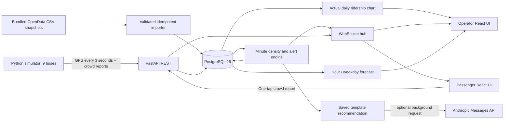

# IDDA · Smart Transit & Crowdsourcing Engine

A runnable hackathon demo for Baku public transport: simulated GPS, passenger crowd reports, live arrivals, route density, operator alerts, recommendations and forecasts.

The app now bundles **3,600 real stops** and **15,686 daily ride observations for 65 BakuBus route codes** from OpenData.az. Recorded daily rides cover **2026-01-01 through 2026-09-30**. The three moving demo lines (`DEMO-A/B/C`), vehicle plates, live GPS, density samples and density forecasts remain simulated. Each demo line uses ten nearby real stops and three simulated buses. These lines are not official BakuBus route paths. The interface is in Azerbaijani.

The passenger screen follows [DESIGN-airbnb.md](DESIGN-airbnb.md): a white canvas, rose accent, segmented route/stop search, route previews and a Google map beside the arrival/report panel. Mobile search opens a native full-screen dialog. Inter replaces the unavailable licensed Cereal font. Passenger styles are scoped; operator and official-route screens retain their existing design. See the [passenger design system](design-system/idda-passenger/MASTER.md) for tokens and accessibility decisions.

The passenger screen opens with the **official AYNA catalog** (209 routes in the verified response). Its route selector includes the entire catalog; three quick-selection cards show the selected route and two other real lines. Selecting a route loads its actual directional road shape, ordered stops, carrier and source tariff. Switch direction or choose a stop from the search or expandable stop list. Official lines have no verified live GPS, ETA or occupancy feed; the UI explains this and does not submit reports against demo IDs. Use **“Demo rejiminə keç”** to access the separate simulated moving buses, arrivals and crowd reporting. The operator demo continues unchanged.

## Official open-data snapshots

The **[Official routes view](http://localhost:5173/#routes)** now integrates the public AYNA route service: 209 route entries with on-demand directional road geometry, ordered stops, carrier and fares. It does not show fake live vehicles. The server caches source responses and marks stale fallback data. See [real-data source verification](docs/REAL_DATA_SOURCES.md) for endpoints, captured examples, cache behavior and the GPS investigation.

| Dataset | Use | Important limitation |
| --- | --- | --- |
| [Stop coordinates](https://opendata.az/@baki-metropoliteni/bakubus-mmc-ye-mexsus-avtobus-marsrutlari-uzre-dayanacaqlarin-cografi-koordinatlari) | All 3,600 stops appear in a searchable, optional map layer; real names and coordinates are reused on demo paths | The CSV provides stop identifiers, names, type and coordinates, but no route membership or ordered route geometry |
| [Daily BakuBus rides, 2026](https://opendata.az/@baki-metropoliteni/bakubus-marsrutlari-uzre-gundelik-sernisin-gedislerinin-sayi-2026) | Operator chart/table with all 65 route codes, 7/30/90-day or full-history filters and daily totals | Counts are payment validations, not unique passengers, hourly density, live occupancy or a timetable |

Snapshots are included in `backend/data`, so startup and tests do not depend on the portal being available. `manifest.json` records resource IDs, download URLs, retrieval/update dates, attribution and source license metadata. The stop dataset lists no specified license; the ridership dataset lists Creative Commons Attribution (`cc-by`). Preserve source attribution and consult the original portal metadata when reusing the snapshots.

On startup the importer validates both changed CSVs before writing, preserves leading-zero stop IDs as `source_id`, checks coordinates and route/day uniqueness, and upserts records. The stop CSV has **two columns named `ID`**: its third column is the actual source identifier. The downloaded snapshot uses decimal degrees, despite the portal description mentioning microdegrees; the parser supports both. The daily date values are ISO dates even though the source column label says day-month-year.

Imports are fingerprinted with SHA-256; restarting does not duplicate records or rebuild demo paths. An additive upgrade supplies provenance columns to an existing demo database and creates `daily_ridership` / `data_imports` tables. Old stops, reports, buses, alerts and density history are retained. Existing demo path links are reassigned to nearby real stops once, without claiming an official route-stop relationship. Startup does not clear historical observations. Set `LOAD_OPEN_DATA=false` only to skip automatic imports; this does not erase previously imported data.

The real daily ride chart is deliberately separate from the synthetic density chart and forecast. Its window ends on the latest observation for that route, so missing October records are not represented as current or invented zeros. No daily ride total is converted into a fabricated 0–100 occupancy measurement.

## Start with Docker

Prerequisites: Docker Engine/Desktop with Compose v2, running in Linux-container mode. Internet access is needed for initial dependency/image downloads and Google Maps. Create `.env` from the example only when it does not already exist, then set `VITE_GOOGLE_MAPS_API_KEY` before building the frontend.

```sh
cp .env.example .env
docker compose up --build
```

PowerShell: use `Copy-Item .env.example .env` for the first command. Keep the local demo credentials in `.env`; never commit keys.

| Interface | URL |
| --- | --- |
| Passenger | http://localhost:5173/#passenger |
| Operator | http://localhost:5173/#operator |
| Official AYNA routes | http://localhost:5173/#routes |
| Swagger / OpenAPI | http://localhost:8000/docs / http://localhost:8000/openapi.json |
| Health | http://localhost:8000/health |
| WebSocket | ws://localhost:8000/ws/live |

Compose starts `db`, `backend`, `frontend`, and `simulator`. PostgreSQL readiness gates the backend; backend readiness gates the other services. Nginx serves the frontend and proxies `/api/*` and `/ws/*` to the backend. Database data persists in the `postgres_data` named volume. `docker compose down` stops the stack and preserves it.

The example enables **demo mode**: the alert observation window becomes one minute. Without `.env`, Compose defaults to normal mode and a ten-minute window. Set `DEMO_MODE=false` and restart the backend for the normal rule.

## Architecture



Backend: Python 3.12 container, FastAPI, Pydantic v2 and SQLAlchemy 2.0. Frontend: React, TypeScript, Vite, Google Maps JavaScript API through `@vis.gl/react-google-maps`, and Recharts. Google Maps replaces the original Leaflet/OpenStreetMap renderer at the user's request. One backend process owns the scheduler and WebSocket hub; run **one worker**. No Redis, PostGIS, authentication or production hosting is required for this local demo.

Tables follow `AGENTS.md`: routes, stops, ordered route stops, buses, positions, crowd reports, density snapshots and alerts, plus source import records and route/day ridership. Additional route fields persist surge controls and alert streaks. Positions are indexed by `(bus_id, ts)`; snapshots by `(route_id, ts)`. A partial unique index enforces one open alert per route. Schema and seed initialization are idempotent; the existing stop-table upgrade is additive. This hackathon version does not include a general migration framework.

## How ETA, density and alerts work

- **ETA:** project the latest GPS point onto the nearest segment of the closed ordered route; sum segment distances to the selected stop using haversine. Passed stops are excluded for the current loop. Average speed uses the last five minutes, with a 5 km/h floor and an 18 km/h default. Fixes older than 30 seconds or over 500 m from the route are excluded. Results are sorted by ETA.
- **Crowd score:** levels 1–5 map to 0–100. Reports in the last five minutes are exponentially weighted with a 120-second decay constant.
- **GPS score:** slower average speed relative to 18 km/h increases the score. Consecutive low-speed observations within 60 m of a stop add dwell pressure after 30 seconds. GPS mixes 70% slowdown with 30% dwell; stale buses are excluded.
- **Route score:** `0.6 * crowd + 0.4 * gps`, with configurable weights summing to one. With only reports, use their score and medium confidence; with only GPS, use its score and low confidence. With neither, return `confidence=unavailable` and an unknown label. Snapshots normally run every 60 seconds and are broadcast live.
- **Colors:** `<40` green / `Rahat`, `40–<70` yellow / `Orta sıxlıq`, `>=70` red / `Sıx`. UI labels accompany colors. Passenger bus crowd labels prefer the latest recent report for that bus, falling back to route density.
- **Alert:** readings at or above 70 must persist for ten minutes, or one minute in demo mode. A lower reading resets the high streak. One alert is saved and broadcast; sustained scores strictly below 60 for two minutes resolve it. The 60–69 hysteresis band does not resolve an open alert. Missing data or an evaluation gap over 90 seconds resets pending streaks, so an outage is not treated as continuous evidence. Streak timestamps survive backend restarts.
- **Demo surge:** the endpoint controls simulator behavior, not a hardcoded density result. A scenario switch opens a fresh observation window, without deleting old reports or positions, and schedules an extra analytics tick after five seconds. The simulator immediately sends new crowd reports when the mode changes. This makes a fresh high-density alert observable in about 65–75 seconds. Disabling surge opens another fresh observation window; allow roughly 2–3 minutes for recovery. These scenario observation cutoffs apply only in demo mode.

## AI integration

Every new alert is immediately saved with a deterministic Azerbaijani recommendation. If `LLM_API_KEY` is set, a background [Anthropic Messages API](https://platform.claude.com/docs/en/api/messages/create) request may improve it. A ten-second timeout, HTTP failure, malformed response or missing key retains the template. GPS ingestion and alert publication do not wait for the provider. `recommendation_source` distinguishes `template` from `llm`. A real paid API call is optional; tests use mocked responses.

The forecast is a small **statistical seasonal baseline**, independent of the LLM: hour proximity in Baku time and day-of-week weighting over the previous 14 days, adjusted by recent measured density. It returns four points, 15/30/45/60 minutes ahead, clamped to 0–100. Seeded synthetic history is explicitly marked in the API and UI, never used as current measured density or to trigger alerts. `insufficient_data=true` marks the zero-valued empty-history fallback. Forecasts and recommendations are demo decision support, not validated operational predictions.

## Configuration

| Variable | Default | Purpose |
| --- | --- | --- |
| `POSTGRES_DB`, `POSTGRES_USER` | `idda` | Compose database identity |
| `POSTGRES_PASSWORD` | `idda_local_demo` | Local demo password; change for any shared installation |
| `DATABASE_URL` | PostgreSQL URL | Direct backend connections; Compose constructs its internal URL from the PostgreSQL variables |
| `DEMO_MODE` | `false` (`true` in example) | One-minute alert window and surge endpoint |
| `LOAD_OPEN_DATA` | `true` | Import bundled official snapshots and attach real stops to demo paths |
| `AYNA_API_URL` | `https://map-api.ayna.gov.az` | Public official route metadata upstream |
| `AYNA_CACHE_HOURS` | `24` | Persistent metadata cache lifetime; stale fallback is labeled |
| `VITE_GOOGLE_MAPS_API_KEY` | empty | Google Maps browser key; set in the ignored root `.env` |
| `VITE_GOOGLE_MAP_ID` | `DEMO_MAP_ID` | Map ID for advanced vehicle markers; use an owned map ID for production |
| `DENSITY_THRESHOLD` | `70` | High-density alert threshold |
| `ALERT_WINDOW_MINUTES` | `10` | Normal alert window; demo mode overrides to 1 |
| `ALERT_HYSTERESIS` | `10` | Recovery threshold offset |
| `RESOLVE_WINDOW_MINUTES` | `2` | Continuous low-density recovery time |
| `CROWD_WEIGHT`, `GPS_WEIGHT` | `0.6`, `0.4` | Nonnegative density weights; must sum to 1 |
| `GREEN_THRESHOLD`, `RED_THRESHOLD` | `40`, `70` | Density label boundaries |
| `LLM_API_KEY` | empty | Optional Anthropic key, backend only |
| `LLM_MODEL` | `claude-haiku-4-5` | Configurable provider model |
| `API_URL` | `http://localhost:8000` | Simulator target; Compose uses `http://backend:8000` |

`/health` reports the effective alert window. Store timestamps in UTC and display times in `Asia/Baku`. Vite development proxies backend requests through the same origin; the Google Maps browser key is configured separately. Server-assigned ingestion timestamps avoid accepting future or forged historical observation times.

### Google Maps setup

Set `VITE_GOOGLE_MAPS_API_KEY=your-browser-key` in the root `.env`, which is ignored by Git. Vite reads that root file in local development; Docker Compose passes the same value to the frontend build. Restart Vite after changing it, or rebuild the frontend image for Docker. The supplied key is configured only in the local ignored file, never in application source or `.env.example`.

Enable **Maps JavaScript API** and billing for the key's Google Cloud project. This is a browser key and is necessarily included in the served JavaScript; use Google's [website/referrer restrictions](https://developers.google.com/maps/api-security-best-practices), including `http://localhost:5173/*`, `http://127.0.0.1:5173/*` and the actual deployment origin as appropriate. Keep server-side secrets such as `LLM_API_KEY` outside the `VITE_` namespace.

All three map views use Google Maps: passenger, operator and official AYNA routes. Native route polylines and a data layer render paths and stop catalogs; advanced markers update simulator buses. The map instance is reused across navigation. Missing keys, script/network loading failure and authentication rejection show a map-local error while the rest of the app remains available. The Google basemap displays the existing AYNA/OpenData information and simulated movement; data provenance and GPS availability remain labeled.

## Demo and API

See [DEMO.md](DEMO.md) for the three-minute walkthrough. Start surge with the operator button or:

```sh
curl -X POST "http://localhost:8000/demo/surge?route_id=1&level=5"
curl "http://localhost:8000/operator/alerts?status=open"
curl -X POST "http://localhost:8000/demo/surge?route_id=1&level=0"
```

In PowerShell, use `curl.exe` or `Invoke-RestMethod -Method Post 'http://localhost:8000/demo/surge?route_id=1&level=5'`. Surge returns 403 outside demo mode. It needs the running simulator to generate the new observations. Simulator CLI alternative: `python simulator/simulate.py --surge-route 1`; `--steps 2` performs a short smoke run.

| Method | Endpoint | Result |
| --- | --- | --- |
| GET | `/health` | DB readiness, demo flag, effective alert window |
| GET | `/routes`, `/routes/{id}`, `/routes/{id}/stops` | Routes and ordered stop paths |
| GET | `/stops`, `/stops/{id}/arrivals` | Stops and fresh sorted arrivals |
| GET | `/routes/{id}/buses` | Buses and latest position or `null` |
| POST | `/gps` | Validated GPS fix (201) |
| POST | `/crowd-reports` | Level 1–5, optional bus belonging to the route (201) |
| GET | `/operator/density` | Latest measured density per route |
| GET | `/operator/density/{id}/history?minutes=60` | Chronological history, synthetic flag |
| GET | `/operator/alerts?status=open` | Open, resolved, or all stored alerts |
| GET | `/operator/forecast/{id}` | Four seasonal forecast points |
| GET | `/data/sources` | Source URLs, licenses, hashes, imported counts and mapping limitations |
| GET | `/official/routes` | Actual AYNA route catalog, source/fetch date and freshness |
| GET | `/official/routes/{source_id}` | Actual directional path/stops, carrier, tariff; no live GPS |
| GET | `/operator/ridership/routes` | 65 actual route codes and recorded daily ride totals |
| GET | `/operator/ridership/{code}?days=30` | Actual daily ride history; e.g. code `62` or `7A` |
| POST | `/demo/surge?route_id=1&level=5` | Demo scenario state; level 0 stops it |
| WS | `/ws/live` | Shared realtime event stream |

Example bodies: GPS `{"bus_id":11,"lat":40.384,"lng":49.848,"speed_kmh":18}`; crowd report `{"route_id":1,"bus_id":11,"level":5}`. Unknown resources return 404, invalid inputs return 422. Latitude/longitude, speed, query ranges, integer crowd levels and bus/route membership are validated.

WebSocket envelopes are `{"type":"bus_position","data":{...}}`. Types: `bus_position`, `crowd_report`, `density_update`, `alert_created`, `alert_resolved`, `alert_updated`, `surge_changed`. Positions include `bus_id`, `route_id`, coordinates, speed and timestamp; density includes route, score, confidence and label; alert events include the stored recommendation and status. No replay is promised: on reconnection the UI reloads REST state. Disconnected clients retry after 2.5 seconds and poll every 15 seconds. Per-client queues are bounded so a slow connection cannot block ingestion.

## Tests

From the repository root, with Python 3.11+:

```sh
python -m venv .venv
# Activate the environment, then:
pip install -r backend/requirements.txt
pytest
```

PowerShell without activation: `.\.venv\Scripts\python.exe -m pip install -r backend/requirements.txt`, then `.\.venv\Scripts\python.exe -m pytest`.

Tests use isolated SQLite databases, with foreign keys enabled, to run without PostgreSQL. They cover route projection, stale/off-route ETA behavior, speed smoothing/floor, density weights/recency, color boundaries, input validation, the full ten-minute alert boundary, interrupted streaks, duplicate prevention, hysteresis/recovery, demo timing, provider fallback, seasonal forecast, idempotent seeds, GPS-to-arrivals, WebSocket delivery and nonblocking LLM behavior. Open-data tests additionally cover source CSV totals, leading-zero IDs, decimal/microdegree coordinates, legacy schema upgrades, preservation of reports, repeat imports, actual daily aggregates and GPS/ETA on imported stops. Time-based unit tests use injected timestamps rather than waiting ten minutes.

Frontend build smoke:

```sh
cd frontend
npm ci
npm run build
```

Inside Compose: `docker compose exec backend pytest` and `docker compose exec backend python -c "import urllib.request; print(urllib.request.urlopen('http://localhost:8000/health').read().decode())"`.

## Local development without Docker

Normal development can use any local PostgreSQL 16 instance and an appropriate `DATABASE_URL`. For a temporary offline demo or tests, the backend also accepts SQLite; the Docker target remains PostgreSQL. Set explicit environment variables in the backend terminal so `.env` does not select the Compose-only hostname `db`.

PowerShell, terminal 1 (repository root, after installing Python requirements):

```powershell
$env:DATABASE_URL = 'sqlite:///./local-demo.db'
$env:DEMO_MODE = 'true'
.\.venv\Scripts\python.exe -m uvicorn backend.app.main:app --host 127.0.0.1 --port 8000
```

Terminal 2:

```powershell
cd frontend
npm.cmd ci
npm.cmd run dev -- --port 5173
```

Terminal 3 (repository root):

```powershell
.\.venv\Scripts\python.exe simulator/simulate.py
```

Use `npm.cmd` on Windows when PowerShell blocks `npm.ps1`. Unix equivalents use `export DATABASE_URL=...`, `export DEMO_MODE=true`, and `.venv/bin/python`.

## Verification and limits

All 48 backend tests, the production frontend build and real Edge desktop/mobile browser checks passed. The simulator-to-REST-to-WebSocket thin slice was checked against a running local backend. A live surge created an alert after 65.7 seconds and resolved it after 126.1 seconds of recovery. Browser checks covered moving markers, live alert/recommendation display, reports, cross-route stop selection, WebSocket reconnection, API failure/recovery, and map tile failures. Compose YAML and PostgreSQL DDL were checked statically. See `PLAN.md` for the final verification record.

Docker is not installed on the implementation host, so a PostgreSQL-container clean start and the complete Compose stack could not be executed here. Compose configuration is supplied, but this remains a required environment-level check on a Docker-enabled machine. No real LLM key was used; provider success and failure are tested using HTTP mocks. Google Maps and web fonts need connectivity; map-local configuration/loading/authentication errors are shown without hiding the rest of the interface. Google Maps was verified in a real browser using the supplied local browser key.

This is an unauthenticated local demo. Do not expose the ingestion, operator, or demo controls publicly. Authentication, rate limiting, schema migrations, retention policies and multi-worker event distribution are outside this hackathon version.
