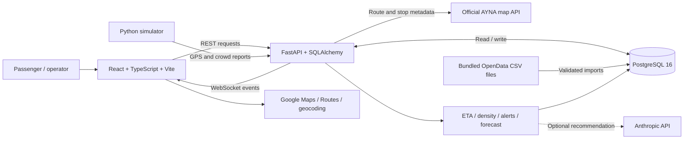

# BakuPort — Baku Transit Planner

BakuPort helps passengers find **walk → bus → walk** journeys across Baku. The operator workspace provides route-density analytics, alerts, recommendations and historical ridership charts. The interface is in Azerbaijani.

[Website](https://bakuport.orucs.net) · [API documentation](https://idda-api.onrender.com/docs)

## Run locally

### Option A: Docker Compose — recommended

Prerequisites: **Git** and **Docker Desktop/Engine with Compose v2**. On Windows, Docker Desktop must be running in Linux-container mode. Internet is required for the first image build, Google Maps and live AYNA requests.

1. **Clone the repository.**

   ```sh
   git clone https://github.com/orucexe/bakuport.git
   cd bakuport
   ```

2. **Create the local environment file.** Skip this step if `.env` already exists.

   ```sh
   cp .env.example .env
   ```

   PowerShell equivalent:

   ```powershell
   Copy-Item .env.example .env
   ```

3. **Configure `.env`.** Set `VITE_GOOGLE_MAPS_API_KEY` to your own Google Maps browser key. Enable Maps JavaScript API; Google Routes walking refinement and address lookup also require the corresponding APIs and permissions. Allow `http://localhost:5173/*` in website restrictions. Demo keys have limited quotas; an exhausted key cannot display the map.

   Keep `VITE_BACKEND_URL` and `VITE_API_BASE_URL` empty for local use. Compose supplies its internal PostgreSQL connection automatically. `DEMO_MODE=true` enables the one-minute alert scenario; normal mode uses ten minutes. `LLM_API_KEY` is optional: recommendations have a deterministic fallback. Never commit `.env` or server-side credentials.

4. **Build and start all four services.** Run from the repository root:

   ```sh
   docker compose up --build
   ```

   Compose starts PostgreSQL 16, FastAPI, the frontend and the GPS/crowd simulator. Database readiness gates backend startup. The backend initializes tables, seed records and bundled data imports automatically; no manual SQL step is required.

5. **Open the application.**

   | Component | Local address |
   | --- | --- |
   | Passenger journey planner | http://localhost:5173/ |
   | Operator login | http://localhost:5173/admin |
   | Official AYNA route explorer | http://localhost:5173/#routes |
   | Swagger API documentation | http://localhost:8000/docs |
   | Backend health check | http://localhost:8000/health |
   | WebSocket stream | ws://localhost:8000/ws/live |

   Select origin/destination, choose a walking limit and search. Choose a bus option to display its boarding stop, traveled route segment and final walking leg. The operator's simulator controls require demo mode and the running simulator. The operator login is a prototype client-side gate, not server-side authorization.

6. **Stop the services when finished.** PostgreSQL data is preserved in the `postgres_data` volume.

   ```sh
   docker compose down
   ```

   To rebuild after changing the browser map key, run `docker compose up --build` again: Vite embeds browser configuration at build time.

### Option B: Development without Docker

Requires **Python 3.11+** (3.12 recommended) and **Node.js 22 with npm**. SQLite can be used for local development; Docker/Render use PostgreSQL. Commands below use PowerShell and assume the repository is already cloned.

1. Create `.env` from `.env.example` and configure the map key as above. For development, change `DATABASE_URL` in `.env` to `sqlite:///./local.db`; keep the two `VITE_*` backend URL settings empty.
2. Install Python dependencies from the repository root:

   ```powershell
   python -m venv .venv
   .\.venv\Scripts\python.exe -m pip install -r backend/requirements.txt -r simulator/requirements.txt
   ```

3. Start the backend in the first terminal:

   ```powershell
   .\.venv\Scripts\python.exe -m uvicorn backend.app.main:app --host 127.0.0.1 --port 8000 --reload
   ```

4. In a second terminal, start the frontend:

   ```powershell
   cd frontend
   npm ci
   npm run dev
   ```

5. In a third terminal at the repository root, optionally start the simulator:

   ```powershell
   .\.venv\Scripts\python.exe simulator/simulate.py --api-url http://127.0.0.1:8000
   ```

   Open http://localhost:5173/. Vite proxies `/api/*` and `/ws/*` to the local backend. On Linux/macOS, use `.venv/bin/python` instead of `.\.venv\Scripts\python.exe`.

## System architecture



- **Frontend:** passenger origin/destination search, map, bus selection and operator analytics. Google Maps renders geometry; Recharts renders density, forecasts and daily rides.
- **Backend:** validates input, fetches/caches official metadata, plans journeys, ingests GPS/reports and calculates analytics. Run one backend worker because its scheduler and WebSocket hub are process-local.
- **Database:** stores routes/stops, GPS fixes, crowd reports, density snapshots, alerts, daily ridership and cached source responses. SQLite is supported for development/tests; production uses PostgreSQL.
- **Request flow:** frontend search → `POST /journeys/search` → nearby stop/line discovery → directional boarding/alighting validation → ranked walking/bus/walking options. Google Routes can refine up to three options with actual pedestrian paths. Source failures retain explicitly labeled estimates or cached data.
- **Live flow:** GPS/report ingestion → database → ETA/density/alert processing → `/ws/live` updates. GPS-based arrivals and future positions are estimates; official route metadata alone does not provide live vehicle positions.

| API | Purpose |
| --- | --- |
| `GET /health` | Backend/database readiness |
| `POST /journeys/search` | Origin/destination journey planning |
| `GET /journeys/vehicles` | Fresh GPS-based arrivals and predicted positions |
| `GET /official/routes`, `/official/routes/{source_id}` | Official catalog, directional geometry, stops and fares |
| `POST /gps`, `/vehicles/gps` | Local simulator and external-provider GPS ingestion |
| `POST /crowd-reports` | Passenger density reports |
| `GET /operator/density`, `/operator/alerts`, `/operator/forecast/{route_id}` | Operator analytics |
| `GET /operator/ridership/routes`, `/operator/ridership/{code}` | Historical daily ride counts |
| `WS /ws/live` | Position, crowd, density and alert events |

Density combines recent crowd reports and GPS slowdown/dwell indicators, normally with weights **0.6 / 0.4**. Sustained high density triggers one open alert per route after **10 minutes**, or **1 minute in demo mode**; recovery uses hysteresis and a two-minute low-density window. Recommendations fall back to templates; forecasts use a small statistical baseline.

## Data sources and limitations

Counts below describe the bundled or verified source snapshots, not a guarantee that upstream data never changes.

| Source | Included information | Usage and boundaries |
| --- | --- | --- |
| [OpenData.az — BakuBus stop coordinates](https://opendata.az/@baki-metropoliteni/bakubus-mmc-ye-mexsus-avtobus-marsrutlari-uzre-dayanacaqlarin-cografi-koordinatlari) | **3,600** stop records | Names, source IDs and coordinates. This CSV does **not** specify ordered route membership. |
| [OpenData.az — daily BakuBus rides, 2026](https://opendata.az/@baki-metropoliteni/bakubus-marsrutlari-uzre-gundelik-sernisin-gedislerinin-sayi-2026) | **15,686** route/day observations across **65** route codes, **January–September 2026** | Operator historical statistics. Counts are payment validations, not unique passengers or live occupancy. |
| [Official AYNA map](https://map.ayna.gov.az/) | **209** catalog entries at verification; directional road shapes, ordered stops, carriers and fares fetched on demand | Not every line is operated by BakuBus. Source IDs differ from route numbers: public line **62** uses source ID **48**. Captured samples include lines 1, 2 and 62. Cached fallback and retrieval dates are disclosed. |
| Google Maps Platform | Basemap, geocoding and optional walking-route geometry/time | Requires a browser key and enabled services. Failed walking refinement remains a labeled straight-line estimate. Manually curated place suggestions are approximate. |
| Local seed and simulator | Seeded paths, vehicle identities, generated GPS/reports and synthetic history | Development fixtures, even when labels resemble actual bus numbers. These are **not verified live operator data** and must not be treated as official route geometry. |

Bundled files live in [`backend/data`](backend/data). [`manifest.json`](backend/data/manifest.json) records OpenData provenance, resource URLs, hashes and license metadata. The ridership source lists `cc-by`; the stop source does not specify a license. Preserve attribution.

**No working official live bus GPS feed has been verified.** Real lines use AYNA metadata; moving simulator vehicles remain simulated. Bus time is scaled from a published route duration where available, otherwise estimated at 18 km/h; waiting is excluded. Walking distances/times use Google Routes when available, otherwise haversine distance and 4.5 km/h. Phone live location is opt-in and is not itself bus GPS. Transfers between buses are not implemented.

## Tests

Backend, from the repository root after installing Python dependencies:

```sh
pytest
```

PowerShell without activating the environment: `.\.venv\Scripts\python.exe -m pytest`. Tests use isolated SQLite databases and mocked provider responses; captured AYNA geometry also has offline regression tests.

Frontend:

```sh
cd frontend
npm ci
npm test
npm run build
```

Coverage includes ETA, walking/bus/walking matching, GPS freshness, density, alert timing/recovery, validation, source imports/cache, provider failure and walking-limit handling. Build validates TypeScript and bundles the frontend. Docker startup must be checked on a host with Docker available.
